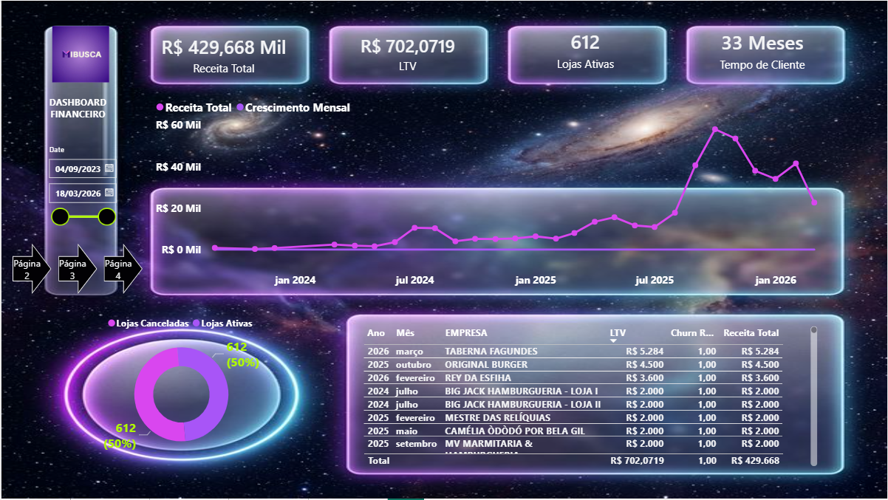
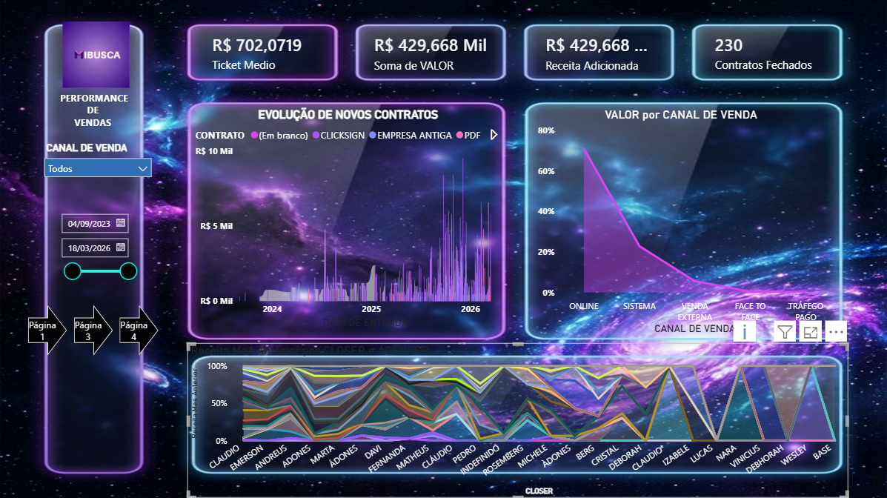
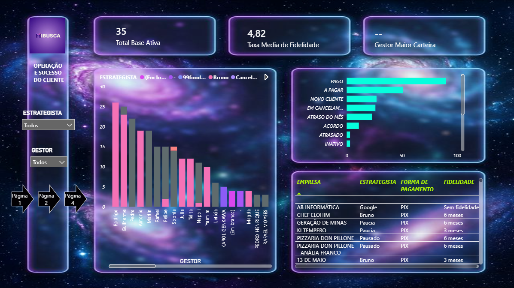
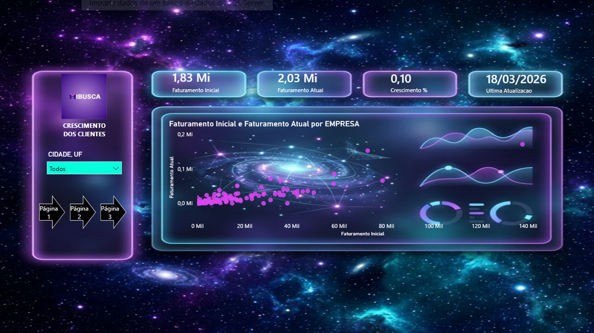
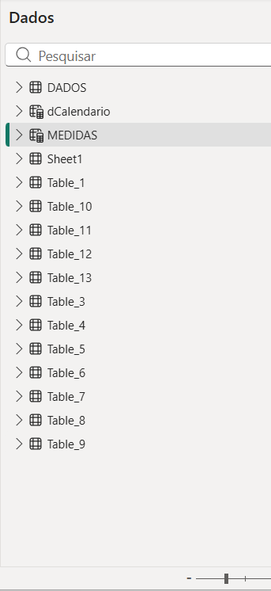
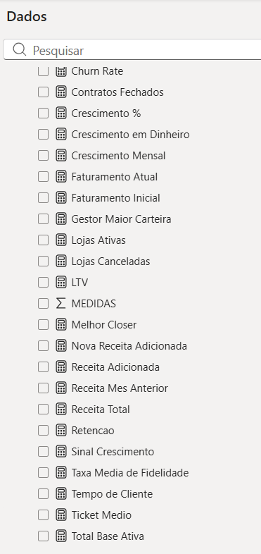

# Dashboard Power BI - MiBusca

Case de Business Intelligence desenvolvido em Power BI para acompanhar crescimento de clientes, performance de vendas, operacao de sucesso do cliente e indicadores financeiros da MiBusca.

## Pergunta de negocio

Como acompanhar a evolucao da base ativa, receita, contratos e fidelidade dos clientes em uma visao executiva e navegavel por area?

## Entregas

- Dashboard financeiro com Receita Total, LTV, Lojas Ativas e Tempo de Cliente.
- Pagina de performance de vendas com Ticket Medio, Receita Adicionada, Contratos Fechados e evolucao de novos contratos.
- Pagina de operacao e sucesso do cliente com Total Base Ativa, Taxa Media de Fidelidade, gestor/estrategista e situacao dos clientes.
- Pagina de crescimento dos clientes comparando Faturamento Inicial, Faturamento Atual e Crescimento.
- Modelo com tabelas de dados, calendario e camada de medidas.
- Medidas DAX para churn, crescimento, faturamento, retencao, ticket medio, LTV, lojas ativas e contratos.

## KPIs destacados

- Receita Total: R$ 429,668 mil.
- LTV: R$ 702,0719.
- Lojas Ativas: 612.
- Tempo de Cliente: 33 meses.
- Ticket Medio: R$ 702,0719.
- Contratos Fechados: 230.
- Total Base Ativa: 35.
- Taxa Media de Fidelidade: 4,82.
- Faturamento Inicial: 1,83 Mi.
- Faturamento Atual: 2,03 Mi.

## Stack

- Power BI.
- Modelagem tabular.
- DAX.
- Calendario analitico.
- Segmentadores por data, canal de venda, cidade, estrategista e gestor.

## Evidencias visuais

